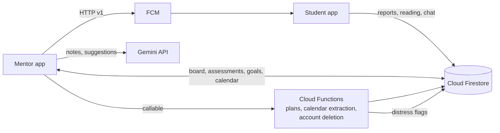

# FOLK — Mentor App

> The private Android app mentors ("guides") use to track, assign and support students in the FOLK spiritual mentorship programme.

## Overview

FOLK is a mentorship platform made of two Flutter apps that share one Firebase backend:

- **Student app**: [Sadhana-App-for-Users](https://github.com/KaushalPawar14/Sadhana-App-for-Users). Students submit daily sadhana (spiritual practice) reports, log their reading and chat with the assistant.
- **Mentor app** (this repo, package `org.folksurat.guides`): guides and the head of department (HOD) use it to see that data across their students, plan follow-ups and run programme activities.

Guides sign in with Google. The app matches their email to an admin record, which then controls what they can see and do.

## Features

**Student board and profiles**
- Kanban-style board. Each column is a guide plus an "Unassigned" column, and each card is a student built live from Firestore.
- Long-press drag-and-drop to reassign students. The HOD can move anyone. Other guides can only claim unassigned students or release their own.
- Student profile with sadhana calendar, scores, graphical analysis (`fl_chart`), book-reading progress and a per-student comment thread.
- An "ABCDE" activity card and hub that summarise a student's activity across the programme's five areas.

**Assessment and follow-up**
- **LIT assessment**: a private, guide-only record with three independent 1–5 axes. The axes are never combined into a single score.
- **Interaction logger**: the guide writes free-text notes, and Gemini (`gemini-2.5-flash`) pulls out themes, concerns, commitments and a suggested next action. The result is saved as a draft that the guide must approve.
- **Holistic suggestion**: Gemini proposes one next step for a student, based on their profile, approved logs and latest LIT reading.
- **Flagged messages**: shows student chat messages that the backend `studentChat` function flagged for distress.
- **Priority students** (a checklist that lists each reason a student needs attention, with no blended score), **overdue associations**, **submission status** and a **Monday weekly-planning** overview.

**Goals and planning**
- Compound semester targets, for example "N students reaching value V" in chanting or books. The Cloud Functions `generateCompoundPlan`, `regenerateCompoundPlan`, `suggestCompoundPlan` and `checkAndAdvanceIfAheadOfSchedule` turn these into multi-phase plans.
- Weekly phase page, progress page, a full roadmap with a free-text suggestion box, and a manual editor for the current phase's tasks.
- HOD review screen for browsing and editing any guide's targets.

**Calendar and programme management**
- Guide calendar with mandatory and personal layers. It can turn pasted text into dated events through the `extractCalendarEvents` function.
- Association (meeting-request) manager, expedition (trip/retreat) manager with registrations and post-trip reflections, collective chanting challenges, and a Service Bank for assigning devotional services.
- Link managers that attach Dropbox URLs to the library's books and podcast/audiobook modules.

**Administration and operations**
- Google Sign-In gated by the `adminUsers` collection, HOD-only admin management, and student registration and deletion (deletion calls the `deleteStudentAuthAccount` function).
- Push notifications through FCM HTTP v1, local notifications for missing reports, notification deep-link routing, and "unseen" badges on the navigation bar.
- Forced update: when the app starts it compares the installed build with `appConfig/versions` in Firestore and shows a blocking screen that links to the Play Store.
- Light/dark theme switching.

## Tech stack

| Layer | Technology |
|---|---|
| App | Flutter (Dart SDK ^3.6), Material 3, Provider, Sizer |
| Backend | Firebase Auth (Google Sign-In), Cloud Firestore, Cloud Functions (callable), Firebase Cloud Messaging |
| AI | Google Gemini API (`gemini-2.5-flash`) for note extraction and suggestions; plan generation runs server-side in Cloud Functions |
| UI | `fl_chart`, `table_calendar`, `lottie`, `curved_navigation_bar`, `flutter_staggered_animations` |
| Platform | Android (release signing through `key.properties`), `package_info_plus` and `url_launcher` for forced updates |

## Architecture



The Cloud Functions source is not in this repo. This app only calls the functions.

## Project structure

```
lib/
├── main.dart            # Firebase init, splash, force-update check, FCM setup
├── Home/                # Board workspace, FOLK Boys entry, student calendar & scores
├── Pages/               # Feature screens (assessment, goals, calendar, managers, admin)
├── Services/            # FCM send/receive, access token, Gemini, local notifications
└── utils/               # Firestore query helpers, auth gate, roster, badges, providers
assets/                  # Lottie animations, Satoshi font
android/                 # Android project (org.folksurat.guides)
videos/folk-guides.mp4   # App walkthrough recording
```

## Getting started

Before you start, install the Flutter SDK (Dart ^3.6), the Android SDK, and get access to the Firebase project.

```bash
git clone https://github.com/KaushalPawar14/Sadhana-App-for-Admin.git
cd Sadhana-App-for-Admin
flutter pub get
```

The app reads secrets from files that are gitignored and not included in this repo:

1. Create `credentials/service-account.json`, the service account the app uses for FCM sends.
2. Create `credentials/gemini-key.json` in the form `{ "apiKey": "..." }`.
3. Copy `.env.template` to `.env` and fill in the values.
4. For release builds, add `android/key.properties` and your keystore.

Then run or build:

```bash
flutter run
flutter build appbundle --release
```

## Demo

[`videos/folk-guides.mp4`](videos/folk-guides.mp4) is a walkthrough of the app.

## Part of FOLK

This repo is the mentor half of the FOLK spiritual mentorship platform. The student half is [Sadhana-App-for-Users](https://github.com/KaushalPawar14/Sadhana-App-for-Users). For more about the project, see [Kaushal Pawar's portfolio](https://portfolio-kaushal-chi.vercel.app).
